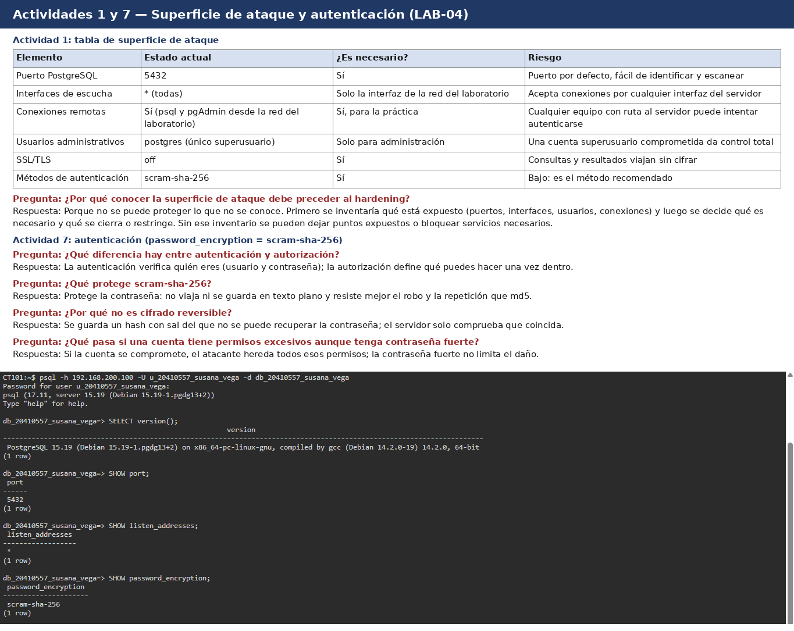
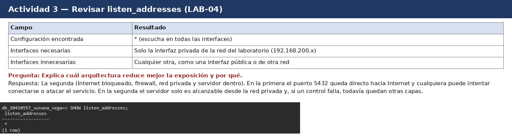
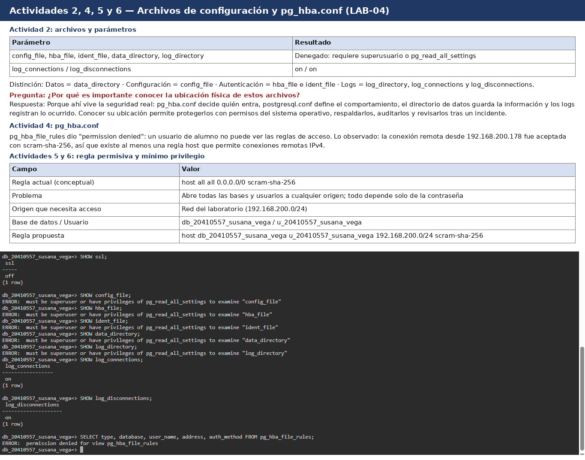
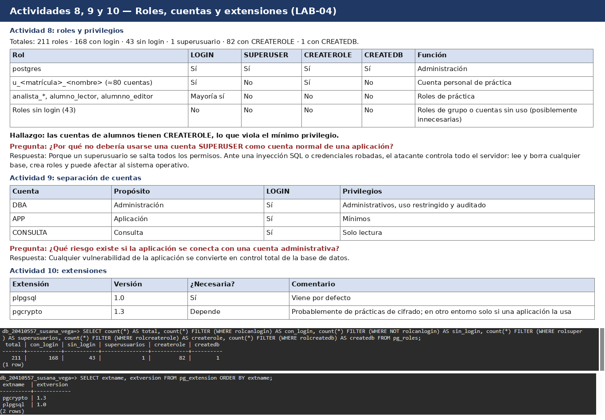
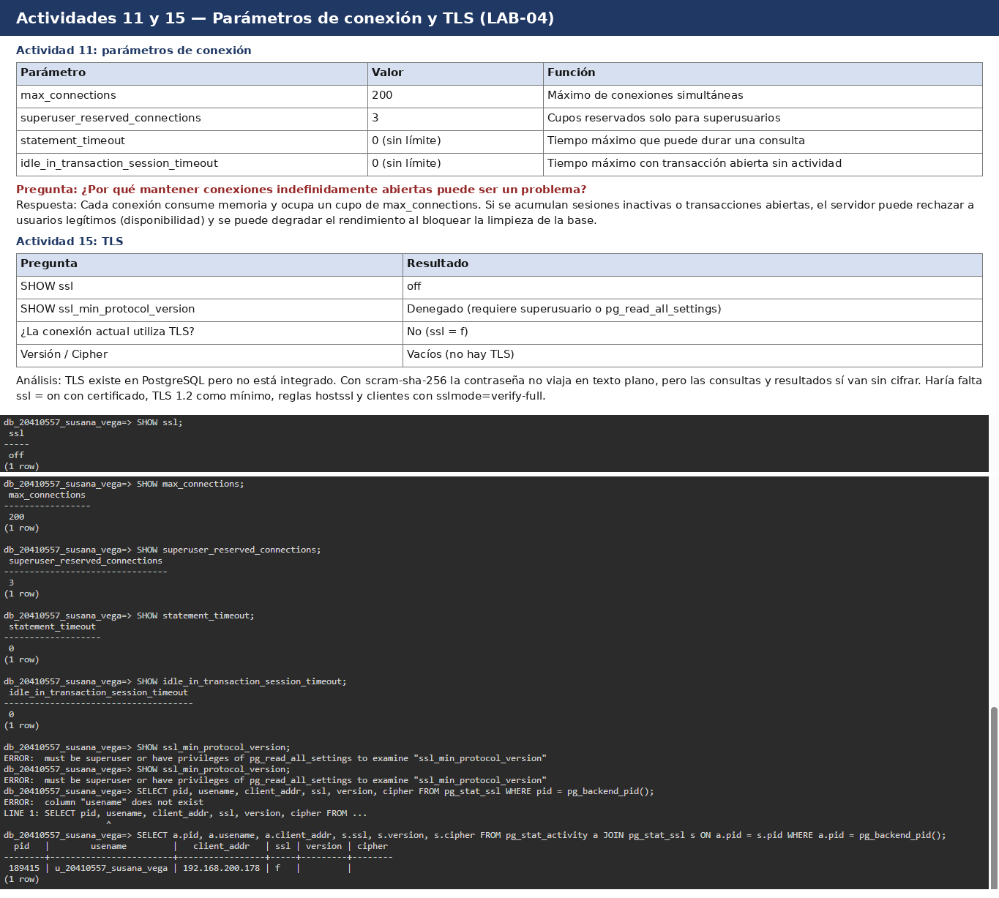
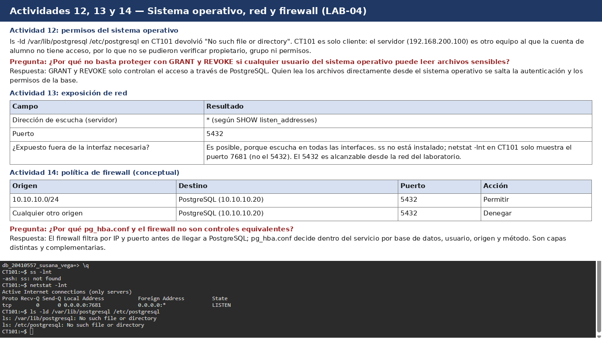

# LAB-04 — Hardening y configuración segura de PostgreSQL

## Objetivo

Identificar la superficie de ataque de un servidor PostgreSQL, revisar su configuración, autenticación, roles y cifrado, y proponer una línea base de seguridad. El laboratorio es de revisión y documentación: no se modificó el servidor.

## Entorno

- Alumna: Susana Valentina Vega García (UAS, Facultad de Informática Culiacán, grupo 4-4)
- Servidor: PostgreSQL 15.19 (Debian 15.19-1.pgdg13+2), x86_64, en 192.168.200.100:5432
- Cliente: terminal web terminal.ficlabs.com.mx (equipo `CT101`, Alpine Linux) con `psql` 17.11, IP 192.168.200.178
- Usuario y base: `u_20410557_susana_vega` / `db_20410557_susana_vega` (cuenta de alumno, sin privilegios administrativos)

## Superficie de ataque inicial



| Elemento | Estado actual | ¿Es necesario? | Riesgo |
|---|---|---|---|
| Puerto PostgreSQL | 5432 | Sí | Puerto por defecto, fácil de identificar y escanear |
| Interfaces de escucha | `*` (todas) | Solo la interfaz de la red del laboratorio | Acepta conexiones por cualquier interfaz del servidor |
| Conexiones remotas | Sí (psql y pgAdmin desde la red del laboratorio) | Sí, para la práctica | Cualquier equipo con ruta al servidor puede intentar autenticarse |
| Usuarios administrativos | `postgres` (único superusuario) | Solo para administración | Una cuenta superusuario comprometida da control total |
| SSL/TLS | `off` | Sí | Consultas y resultados viajan sin cifrar |
| Métodos de autenticación | `scram-sha-256` | Sí | Bajo; es el método recomendado |

**¿Por qué conocer la superficie de ataque debe preceder al hardening?** Porque no se puede proteger lo que no se conoce. Primero se inventaría qué está expuesto (puertos, interfaces, usuarios, conexiones) y luego se decide qué es necesario y qué se cierra o restringe. Sin ese inventario se pueden dejar puntos expuestos o bloquear servicios necesarios.

## Hallazgos

1. `listen_addresses = *`: el servidor escucha en todas las interfaces.
2. `ssl = off`: la conexión no usa TLS (`pg_stat_ssl`: `ssl = f`, sin versión ni cipher).
3. `password_encryption = scram-sha-256`: correcto.
4. 211 roles: 168 con login, 43 sin login, 1 superusuario, 82 con `CREATEROLE`, 1 con `CREATEDB`. Las cuentas de alumnos tienen `CREATEROLE`, lo cual viola el mínimo privilegio.
5. `statement_timeout = 0` e `idle_in_transaction_session_timeout = 0`: sin límite de tiempo.
6. `max_connections = 200` y `superuser_reserved_connections = 3`.
7. Extensiones: `plpgsql 1.0` y `pgcrypto 1.3` (esta última probablemente de prácticas).
8. `log_connections` y `log_disconnections` en `on`: bien, dejan registro.
9. `config_file`, `hba_file`, `ident_file`, `data_directory`, `log_directory`, `ssl_min_protocol_version` y la vista `pg_hba_file_rules` dieron *permission denied*: un usuario normal no ve datos internos del servidor (control positivo), pero impide revisar `pg_hba.conf`.
10. `CT101` es solo cliente: no tiene PostgreSQL (`/var/lib/postgresql` y `/etc/postgresql` no existen) y `netstat -lnt` solo muestra el puerto 7681; `ss` no está instalado.

**Evidencia:**











## Cambios realizados

Ninguno. Los cambios propuestos están en `configuracion/cambios.md`.

## Justificación de los cambios

Los cambios propuestos reducen la exposición (interfaces y redes), cifran el tráfico (TLS), aplican mínimo privilegio (quitar `CREATEROLE`, regla específica en `pg_hba.conf`) y limitan el consumo de recursos (timeouts). La regla propuesta para `pg_hba.conf` es:

```
host    db_20410557_susana_vega    u_20410557_susana_vega    192.168.200.0/24    scram-sha-256
```

## Verificación

Los scripts de `sql/` reproducen las consultas ejecutadas y las capturas de `evidencias/` muestran los resultados. No fue posible verificar desde el servidor: permisos del sistema operativo, firewall ni `pg_hba.conf`, por falta de acceso. Además, la consulta de TLS del laboratorio (`pg_stat_ssl` con `usename`) falla porque esa vista no tiene esas columnas; se corrigió con un `JOIN` a `pg_stat_activity` (`sql/04-verificacion.sql`).

## Checklist de hardening

| # | Control | Verificado | Evidencia |
|---|---|---|---|
| 1 | Puerto documentado | Sí | `SHOW port` = 5432 |
| 2 | Interfaces de escucha justificadas | Revisado, no cumple | `listen_addresses = *` |
| 3 | `pg_hba.conf` revisado | No verificable | `permission denied` en `pg_hba_file_rules` |
| 4 | Redes autorizadas restringidas | No verificable | Sin acceso a `pg_hba.conf`; la conexión remota fue aceptada |
| 5 | Autenticación segura | Sí | `password_encryption = scram-sha-256` |
| 6 | Superusuarios identificados | Sí | 1 superusuario (consulta de totales) |
| 7 | Cuentas de aplicación separadas | Parcial | Diseño DBA/APP/CONSULTA propuesto; roles `analista_*` y `u_*` por persona |
| 8 | Privilegios mínimos | Revisado, no cumple | 82 roles con `CREATEROLE` |
| 9 | Extensiones revisadas | Sí | `pgcrypto 1.3`, `plpgsql 1.0` |
| 10 | TLS verificado | Revisado, no cumple | `ssl = off`, `pg_stat_ssl.ssl = f` |
| 11 | Configuración protegida | Parcial | `SHOW config_file` denegado a usuarios normales |
| 12 | Directorio de datos protegido | No verificable | `SHOW data_directory` denegado; sin acceso al servidor |
| 13 | Firewall documentado | Parcial | Política conceptual (Actividad 14); firewall real no accesible |
| 14 | Actualizaciones documentadas | Parcial | Versión 15.19 identificada; política de actualización propuesta en el baseline |
| 15 | Configuración registrada | Sí | `cambios.md` y `baseline.md` |
| 16 | Registro de conexiones | Sí | `log_connections` y `log_disconnections` en `on` |
| 17 | Límites de tiempo de consultas y sesiones | Revisado, no cumple | Ambos timeouts en 0 |

## Conclusiones

El servidor tiene buenas bases (SCRAM, registro de conexiones, parámetros internos ocultos a usuarios normales), pero presenta exposición innecesaria: escucha en todas las interfaces, no usa TLS, muchas cuentas tienen `CREATEROLE` y no hay límites de tiempo en consultas ni sesiones. Una contraseña fuerte no basta: el hardening combina autenticación, autorización, red, configuración, sistema operativo y monitoreo. Las limitaciones del entorno de alumno impidieron revisar `pg_hba.conf`, el sistema operativo y el firewall del servidor.
